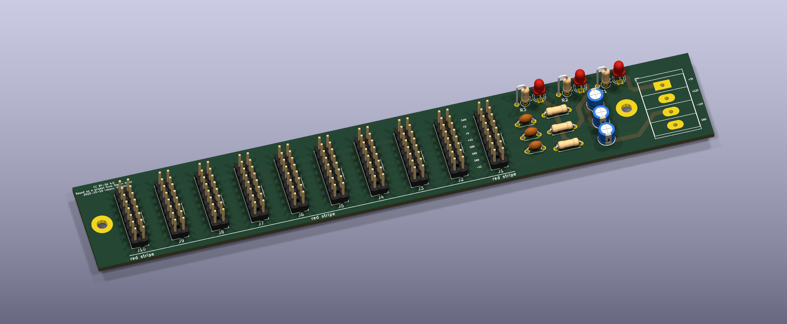

# Eurorack Power Busboard

A passive power busboard for a Eurorack case, based on the
[Eurorack Power Breakout](https://github.com/moPsy-project/eurorack-power-breakout) by Stefan Haun
(moPsy project). I took Stefan KiCad project as a starting point and started playing around with it
to create the busboard to power my modules.

* 10 Eurorack power headers (2×8, with +5V, CV and Gate)
* Power input on a 4-pin WAGO screw terminal (+12V, GND, -12V, +5V)
* Basic filtering on each rail (ferrite bead, 100n and 10u)
* One LED per rail (+12V, -12V, +5V)
* Through-hole parts only, 190 × 31 mm, two M3 mounting holes

## Status

I built it and it works. Some things might need correcting, mostly the position of a few parts and
labels, so check the layout!

I have some spare PCBs. If you want one, get in touch!

## Files

* `eurorack-power-breakout.kicad_pro` / `.kicad_sch` / `.kicad_pcb`: KiCad project
* `eurorack-power-breakout-gerbers.zip`: Gerbers and drill files, ready to upload to a PCB fab
* `plots/`: the same Gerbers and drill files, unzipped
* `images/`: 3D renders (`board-3d.png`, `board-top.png`)
* `eurorack-power-breakout.csv`: bill of materials

## License

Licensed under [Creative Commons Attribution-ShareAlike 4.0 International](http://creativecommons.org/licenses/by-sa/4.0/),
like the original. Original design by Stefan Haun (mail@tuxathome.de), modified by Roberto
Barumerli. See [LICENSE.txt](LICENSE.txt).
